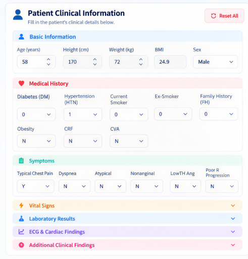
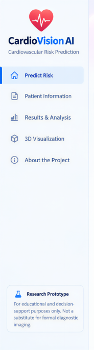
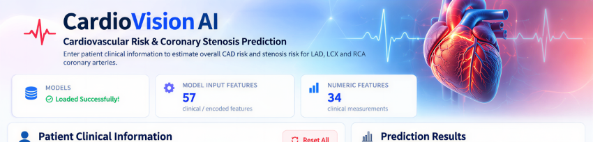

# CardioVision AI — Explainable Cardiovascular Risk Intelligence Platform

> **IIT Mandi Multimodal AI Hackathon 2026 — Track A: Cardiovascular Risk Visualization & Prediction**  
> *Explainable Multimodal AI Research Prototype for Non-Invasive Coronary Artery Disease Risk Assessment & Anatomical 3D Spatial Telemetry*

[](https://www.python.org/downloads/)
[](https://scikit-learn.org/)
[](https://threejs.org/)
[](https://www.reportlab.com/)
[](LICENSE)
[]()

---

## 1. Project Inspiration & Problem Statement

Coronary Artery Disease (CAD) remains the leading cause of mortality worldwide. Conventional clinical risk assessment tools (such as Framingham Risk Score or ASCVD Pooled Cohort Equations) estimate generic 10-year systemic cardiovascular event risk without identifying **vessel-specific stenosis** in the epicardial coronary tree (Left Anterior Descending, Left Circumflex, and Right Coronary Artery). Furthermore, clinical workflows are burdened by unstructured medical reports (laboratory printouts, electronic health record PDFs, scanned referral notes) that require laborious manual data transcription.

**CardioVision AI** addresses these challenges by uniting:
1. Automated clinical document parsing with human-in-the-loop review.
2. An immutable canonical 57-feature vector preventing data drift.
3. Multi-vessel risk prediction across the major coronary arteries (CAD, LAD, LCX, RCA).
4. Mathematically consistent patient-specific SHAP explanations.
5. Interactive Three.js 106-mesh anatomical 3D heart visualization with vessel-specific telemetry overlays.
6. SQLite session history and publication-grade multi-page research PDF reports.

---

## 2. Solution Overview & Key Workflows

```
┌─────────────────────────────────┐      ┌─────────────────────────────────┐      ┌─────────────────────────────────┐
│     Multimodal Data Ingestion   │      │   Validated Clinical Snapshot   │      │    Explainability & Output      │
│ • Digital & Scanned Reports     │ ───► │ • Canonical 57-feature matrix   │ ───► │ • Multi-vessel risk (CAD, LAD,  │
│ • Laboratory result tables      │      │ • Deterministic SHA-256 hash    │      │   LCX, RCA)                     │
│ • Analyte unit conversions      │      │ • Zero silent clipping or drift │      │ • Mathematical SHAP waterfalled │
│ • Human-in-the-loop review table│      │ • Dual Standard/Candidate modes │      │ • 106-mesh 3D anatomical viewer │
│                                 │      │                                 │      │ • Multi-page research PDF export│
└─────────────────────────────────┘      └─────────────────────────────────┘      └─────────────────────────────────┘
```

---

## 3. Working Dashboard & Visual Showcase

| Interactive Clinical Dashboard | Three.js 106-Mesh Anatomical Heart Overlay |
|:---:|:---:|
|  |  |

| Multi-Vessel Prediction Cards | Publication-Grade Multi-Page PDF Dossier |
|:---:|:---:|
|  |  |

---

## 4. Unstructured Medical Report Extraction Pipeline

CardioVision AI incorporates a robust document ingestion engine (`backend/clinical_extractor.py`) designed for clinical documents:

- **Format Support**: Parses digital text-based PDFs (PyMuPDF), multi-page laboratory dossiers, and Microsoft Word reports (`.docx`).
- **Scanned Document Handling**: Detects raster image pages with an automated fallback to Tesseract OCR (`pytesseract`), issuing a descriptive notice if OCR is unavailable.
- **Reference Range Exclusion**: Disregards parenthetical reference intervals (e.g., `(Ref: 70-99 mg/dL)`) and test codes before extracting measured values, preventing false-positive biomarker assignment.
- **Analyte-Specific Unit Conversions**:
  - Height: ft/in, in, m $\rightarrow$ cm
  - Weight: lbs $\rightarrow$ kg
  - Glucose: mmol/L $\rightarrow$ mg/dL ($\times 18.0182$)
  - Creatinine: $\mu\text{mol/L} \rightarrow \text{mg/dL}$ ($\div 88.4$)
  - Total Cholesterol / LDL / HDL: mmol/L $\rightarrow$ mg/dL ($\times 38.67$)
  - Triglycerides: mmol/L $\rightarrow$ mg/dL ($\times 88.57$)
  - WBC: $10^3/\mu\text{L}, \text{K}/\mu\text{L} \rightarrow /\mu\text{L}$ ($\times 1000$)
- **Human-Reviewed Review Table**: Extracted fields are displayed in an interactive table categorizing confidence into `Extracted`, `Calculated`, `Needs Review`, and `Not Found`. Clinical staff can inspect source page citations and raw snippets before applying values.
- **Stale State Invalidation**: Applying extracted values immediately invalidates prior predictions, charts, SHAP explanations, and 3D overlays, resetting the application state to "Awaiting Prediction".

---

## 5. Four-Model Cardiovascular Prediction Architecture

The platform evaluates four independent, trained scikit-learn models targeting the primary coronary vasculature:

1. **CAD Model** (`models/cad_model.pkl`): Evaluates overall coronary artery disease risk ($\ge 50\%$ stenosis in $\ge 1$ major epicardial coronary artery).
2. **LAD Model** (`models/lad_model.pkl`): Evaluates stenosis in the Left Anterior Descending artery (the anterior wall and septum supplier).
3. **LCX Model** (`models/lcx_model.pkl` / `models/lcx_model_candidate.pkl`): Evaluates stenosis in the Left Circumflex artery (the lateral and posterior myocardial supplier).
4. **RCA Model** (`models/rca_model.pkl` / `models/rca_model_candidate.pkl`): Evaluates stenosis in the Right Coronary Artery (the inferior wall and right ventricular supplier).

---

## 6. Canonical 57-Feature Vector

To prevent data drift and silent mutation, all components interact through an immutable canonical 57-dimensional vector (`feature_columns.pkl`):

| Category | Count | Features Included |
|---|:---:|---|
| **Demographics** | 4 | Age, Stature (Length), Body Weight, Sex (One-hot encoded) |
| **Medical History** | 8 | Diabetes Mellitus (DM), Hypertension (HTN), Current Smoker, Ex-Smoker, Family History (FH), Obesity, Chronic Renal Failure (CRF), Cerebrovascular Accident (CVA) |
| **Symptom Presentation** | 6 | Typical Chest Pain, Dyspnea, Atypical Chest Pain, Nonanginal Pain, Low-Threshold Angina, Poor R-Wave Progression |
| **Vital Signs & Echo** | 4 | Systolic Blood Pressure (BP), Pulse Rate (PR), Left Ventricular Ejection Fraction (EF-TTE), Regional Wall Motion Abnormality (Region RWMA) |
| **Laboratory Biomarkers** | 14 | Fasting Blood Sugar (FBS), Serum Creatinine (CR), Triglycerides (TG), LDL Cholesterol, HDL Cholesterol, BUN, ESR, Hemoglobin (HB), Potassium (K), Sodium (Na), WBC, Lymphocyte %, Neutrophil %, Platelets (PLT) |
| **ECG Findings** | 5 | Pathologic Q-Wave, ST Elevation, ST Depression, T-Wave Inversion, Left Ventricular Hypertrophy (LVH) |
| **Cardiac Telemetry & Exam** | 16 | Bundle Branch Blocks (BBB Normal / RBBB), Valvular Heart Disease (VHD Normal / Mild / Severe), Functional Class, Peripheral Pulse, Heart Murmurs, Lung Rales, Edema, Chronic Heart Failure (CHF), Dyslipidemia (DLP) |

---

## 7. Patient-Specific SHAP Explanations

CardioVision AI provides mathematically rigorous feature attributions via SHAP (SHapley Additive exPlanations):

- **Linear Models (CAD & RCA)**: Explanations operate on the **log-odds margin scale** ($f(x) \in \mathbb{R}$) using `shap.LinearExplainer`. The output probability strictly satisfies:
  $$P(\text{Risk}) = \sigma(f(x)) = \frac{1}{1 + e^{-f(x)}}$$
- **Tree Ensembles (LAD & LCX)**: Explanations operate directly on the **probability scale** ($f(x) \in [0, 1]$) using `shap.TreeExplainer`.
- **Exact Additivity**: Every explanation satisfies the efficiency property:
  $$\mathbb{E}[f(x)] + \sum_{i=1}^{M} \phi_i = f(x)$$
- **Waterfall Decomposition**: Visualizes top positive risk drivers (red) and protective factors (blue) alongside a mathematically verified `Remaining Features` balance term.

---

## 8. Interactive Three.js 106-Mesh Anatomical Visualization

The 3D cardiac viewer (`frontend/components/heart_viewer.html`) renders an anatomically curated 106-mesh heart model based on the BodyParts3D ontology:

- **Anatomical Context**: Visualizes ventricles, atria, great vessels, and epicardial coronary arteries without claiming patient-specific geometry.
- **Live Vessel Telemetry**: Synchronized risk colors highlight coronary branches based on prediction output:
  - **LAD**: Left anterior descending branch
  - **LCX**: Left circumflex branch
  - **RCA**: Right coronary artery branch
  - **LM Stem**: Left main coronary stem
- **Demand-Driven Rendering**: Utilizes `requestRender()` to cap resource utilization, pauses rendering during tab switching (`VIEWER_HIDDEN`), and caps device pixel ratio at 1.5.
- **Direct Route Serving**: Served on `/viewer.html` on the same origin (`http://127.0.0.1:8502`), eliminating brittle `srcdoc` injections, deprecated iframe permissions, and sandbox security warnings.

---

## 9. Prediction History & Multi-Page Research PDF Export

- **Local Session History**: Stores evaluations with their 57-feature snapshot, probability predictions, and SHAP explanations in an audit-ready SQLite database (`data/prediction_history.db`).
- **Search & Filter**: Allows instant filtering by patient name, record ID, or model mode.
- **Dynamic Multi-Page PDF Export**: Generates publication-ready research reports including:
  - Document header with patient demographics and physical assessment.
  - Complete 54-field clinical measurement table.
  - Multi-vessel risk summary with classification thresholds.
  - Four patient-specific SHAP waterfall charts.
  - Embedded high-resolution 3D anatomical heart capture with coronary telemetry.
  - Dynamic pagination with running headers, footers (`Page X of Y`), and comprehensive disclaimers.

---

## 10. Standard Mode vs. Experimental Candidate Mode

Users can toggle between two operational configurations:

### Standard Mode
- **Models**: Baseline production models (`cad_model.pkl`, `lad_model.pkl`, `lcx_model.pkl`, `rca_model.pkl`).
- **Thresholds**: Canonical $0.50$ (50.0%) decision thresholds across all four vessels.

### Experimental Candidate Mode
- **Models**: Evaluates candidate models (`lcx_model_candidate.pkl`, `rca_model_candidate.pkl`) alongside baseline CAD and LAD models.
- **Thresholds**:
  - CAD: $0.50$ (50.0%)
  - LAD: $0.50$ (50.0%)
  - **LCX Candidate**: $0.45$ (45.0%)
  - **RCA Candidate**: $0.40$ (40.0%)

> [!IMPORTANT]
> **Threshold Adjustment vs. Probability Calibration**:
> Adjusting decision thresholds (e.g., to $0.45$ or $0.40$) alters classification sensitivity and specificity for research exploration. Lowering thresholds does **not** calibrate predicted probabilities.

---

## 11. Model Evaluation Results

Retrospective baseline evaluation on the Z-Alizadeh Sani development cohort:

| Target Model | Primary Target Endpoint | Algorithm | Baseline ROC-AUC | Decision Threshold |
|---|---|---|:---:|:---:|
| **CAD Model** | Global Coronary Artery Disease | Logistic Regression | **0.917** | 0.50 |
| **LAD Model** | Left Anterior Descending Stenosis | Random Forest | **0.756** | 0.50 |
| **LCX Model** | Left Circumflex Stenosis | Random Forest | **0.584** | 0.50 |
| **RCA Model** | Right Coronary Artery Stenosis | Logistic Regression | **0.652** | 0.50 |

### Research Observations on Baseline Performance
- The CAD model demonstrates excellent overall discrimination ($\text{ROC-AUC} = 0.917$).
- The LAD model achieves moderate discrimination ($\text{ROC-AUC} = 0.756$).
- **Limited Discrimination Notice**: Baseline LCX ($\text{ROC-AUC} = 0.584$) and RCA ($\text{ROC-AUC} = 0.652$) models exhibit limited discriminatory performance on this cohort. Lateral and inferior vessel involvement often produce non-specific non-invasive findings. In adherence to scientific transparency, these limitations are explicitly documented rather than artificially inflated.

---

## 12. Technology Stack

- **Backend**: Python 3.10+, Standard Library `http.server`, SQLite3.
- **Machine Learning & Explainability**: `scikit-learn` (1.3 - 1.6), `shap` (0.45 - 0.49), `pandas`, `numpy`, `joblib`.
- **Multimodal Extraction**: `pymupdf` (PyMuPDF 1.24+), `python-docx`, `beautifulsoup4`, `pytesseract` (Tesseract OCR).
- **PDF Generation**: `reportlab` (4.0+), `matplotlib` (3.7+), `Pillow`.
- **Frontend & 3D Visualization**: HTML5, Vanilla JavaScript, CSS3, `Three.js` (WebGL 3D engine, OrbitControls, OBJLoader).

---

## 13. Project Directory Structure

```text
CardioVision-AI/
│
├── README.md                           # Master project documentation
├── requirements.txt                    # Pinned, compatible dependencies
├── .gitignore                          # Clean security and cache exclusions
├── .env.example                        # Environment configuration template
├── LICENSE                             # MIT license and third-party notices
│
├── app.py                              # Optional Streamlit application entry point
├── api_server.py                       # High-performance REST API & static server (Port 8502)
│
├── frontend/                           # Client interface assets
│   ├── cardiovision_exact_dashboard.html # Interactive single-page clinical dashboard
│   ├── assets/                         # Dashboard headers, badges, and background graphics
│   └── components/
│       └── heart_viewer.html           # Dedicated Three.js 106-mesh 3D anatomical viewer
│
├── backend/                            # Core engineering services
│   ├── __init__.py
│   ├── clinical_extractor.py          # Multimodal medical report extraction engine
│   ├── patient_feature_snapshot.py     # Canonical 57-feature snapshot & state validation
│   ├── shap_service.py                 # Tree and Linear SHAP explainability service
│   ├── pdf_generator.py                # Multi-page ReportLab research PDF generator
│   └── history_service.py              # SQLite session history service
│
├── models/                             # Serialized trained machine learning models
│   ├── cad_model.pkl                   # CAD predictive model
│   ├── lad_model.pkl                   # LAD predictive model
│   ├── lcx_model.pkl                   # Standard LCX predictive model
│   ├── rca_model.pkl                   # Standard RCA predictive model
│   ├── lcx_model_candidate.pkl         # Experimental LCX candidate model
│   ├── rca_model_candidate.pkl         # Experimental RCA candidate model
│   ├── feature_columns.pkl             # Canonical 57-feature ordering vector
│   ├── numeric_defaults.pkl            # Median reference fallback values
│   └── candidate_thresholds.json       # Candidate threshold definitions
│
├── assets/
│   └── heart_3d/                       # 106 anatomical OBJ meshes (BodyParts3D)
│
├── data/
│   ├── README.md                       # Dataset documentation and attribution
│   └── z_alizadeh_sani_dataset.xlsx    # Benchmark dataset reference copy
│
├── tests/                              # Comprehensive automated test suites
│   ├── verify_prediction_state_sync.py # Invalidation & state synchronization test
│   ├── verify_57_features_sync.py      # Full 57-feature end-to-end sync test
│   ├── verify_medical_report_extraction_10_tests.py # 10-scenario clinical extraction test
│   ├── verify_synthetic_patient_test.py# Synthetic patient extraction & inference test
│   ├── verify_all_12_tests.py          # 12-scenario full regression suite
│   ├── verify_all_22_scenarios.py      # 22-scenario comprehensive end-to-end suite
│   ├── verify_all_synchronization_scenarios.py # Asynchronous state synchronization test
│   ├── verify_prediction_shap_synchronization.py # SHAP additivity & API rejection test
│   └── fixtures/                       # Synthetic, fictional patient PDF test documents
│
├── evaluation/                         # Model evaluation scripts
│   ├── evaluate_nested_cv.py          # Nested cross-validation verification script
│   └── nested_cv_results.json          # Empirical evaluation results
│
├── docs/                               # Architecture and submission documentation
│   ├── ARCHITECTURE.md                 # Detailed architectural blueprint
│   ├── MODEL_EVALUATION.md             # Model metrics, discrimination, and limitations
│   ├── DEMO_VIDEO_SCRIPT.md            # Video walkthrough script
│   ├── HACKATHON_SUBMISSION_CHECKLIST.md # Submission checklist
│   └── screenshots/                    # Dashboard and evaluation screenshots
│
└── scripts/                            # Reproducible startup scripts
    ├── run_app.bat                     # Windows startup script
    └── run_app.sh                      # Linux / macOS startup script
```

---

## 14. Installation & Quickstart

### Prerequisites
- Python 3.10, 3.11, or 3.12
- Modern web browser (Chrome, Edge, Firefox, Safari) with WebGL enabled
- *(Optional)* Tesseract OCR for scanned raster PDF extraction

### 1. Clone & Set Up Virtual Environment

```bash
git clone https://github.com/cardiovision/cardiovision-ai.git
cd cardiovision-ai

# Create virtual environment
python -m venv venv

# Activate virtual environment
# On Windows:
venv\Scripts\activate
# On Linux / macOS:
source venv/bin/activate

# Install dependencies
pip install -r requirements.txt
```

### 2. Launch the Application

#### Option A: Using Startup Scripts
- **Windows**:
  ```cmd
  scripts\run_app.bat
  ```
- **Linux / macOS**:
  ```bash
  chmod +x scripts/run_app.sh
  ./scripts/run_app.sh
  ```

#### Option B: Direct Python Execution
```bash
python api_server.py
```

Open your browser and navigate to:
```text
http://127.0.0.1:8502/dashboard
```

---

## 15. REST API Documentation

CardioVision AI provides a clean RESTful interface:

| Method | Endpoint | Description |
|---|---|---|
| `POST` | `/api/predict` | Computes 4-vessel predictions and SHAP explanations from patient features. |
| `POST` | `/api/upload-report` | Extracts clinical biomarkers from an uploaded PDF, DOCX, or image. |
| `POST` | `/api/generate-pdf` | Generates a 3-page research PDF dossier from a validated patient snapshot. |
| `GET` | `/api/history` | Retrieves recent evaluations with summary metrics (`?search=...&mode=...`). |
| `GET` | `/api/history/{id}` | Fetches detailed snapshot record for a specific evaluation ID. |
| `GET` | `/api/history/{id}/export-pdf` | Generates an authentic PDF report for a historical evaluation snapshot. |
| `DELETE`| `/api/history/{id}` | Removes an evaluation record from the database. |
| `GET` | `/viewer.html` | Serves the standalone Three.js 106-mesh anatomical 3D heart viewer. |
| `GET` | `/models/{filename}` | Serves 3D OBJ meshes for client-side WebGL rendering. |

---

## 16. Running Automated Verification Tests

The platform includes exhaustive regression test suites:

```bash
# 1. Full 57-Feature Clinical Synchronization Suite (57/57 Features PASS)
python tests/verify_57_features_sync.py

# 2. 10-Scenario Clinical Document Extraction Suite (10/10 Tests PASS)
python tests/verify_medical_report_extraction_10_tests.py

# 3. 12-Scenario Full Regression Suite (12/12 Tests PASS)
python tests/verify_all_12_tests.py

# 4. 22-Scenario Comprehensive End-to-End Suite (22/22 Tests PASS)
python tests/verify_all_22_scenarios.py

# 5. Prediction State & Invalidation Sync Suite (8/8 Tests PASS)
python tests/verify_prediction_state_sync.py

# 6. Synthetic Patient Extraction & Inference Suite (6/6 Tests PASS)
python tests/verify_synthetic_patient_test.py
```

---

## 17. Datasets & Third-Party Asset Attributions

1. **Z-Alizadeh Sani Cardiovascular Dataset**:
   - Citation: Alizadehsani et al. (2013), *Scientific Reports*. Available at the [UCI Machine Learning Repository](https://archive.ics.uci.edu/dataset/412/z+alizadeh+sani).
   - License: Creative Commons Attribution 4.0 International (CC BY 4.0).
2. **BodyParts3D Anatomical Heart Meshes**:
   - Origin: Database Center for Life Science (DBCLS), Research Organization of Information and Systems (ROIS), Japan.
   - License: Creative Commons Attribution-ShareAlike 2.1 Japan (CC BY-SA 2.1 JP).
3. **Three.js Engine**:
   - License: MIT License. Copyright (c) 2010-2026 Three.js authors.

---

## 18. Research Limitations & Medical Disclaimer

> [!CAUTION]
> **RESEARCH SOFTWARE PROTOTYPE — NOT A CERTIFIED MEDICAL DEVICE**
> - **CardioVision AI is strictly a scientific research prototype and educational demonstration** developed for the IIT Mandi Multimodal AI Hackathon 2026.
> - It is **not** cleared, certified, or approved as a medical device by the U.S. FDA, European CE, CDSCO, or any regulatory body.
> - It has **not** undergone prospective randomized clinical trials or multi-center external clinical validation.
> - Baseline models for LCX ($\text{ROC-AUC} = 0.584$) and RCA ($\text{ROC-AUC} = 0.652$) have limited discriminatory power on non-invasive data.
> - The application does not perform patient-specific coronary lumen reconstruction or computational fluid dynamics.
> - **This software must never be used as a standalone diagnostic system or to direct clinical treatment decisions.**

---

## 19. Hackathon Links & Deliverables

- **Track**: Track A — Cardiovascular Risk Visualization & Prediction
- **Event**: IIT Mandi Multimodal AI Hackathon 2026
- **Architecture Documentation**: [`docs/ARCHITECTURE.md`](docs/ARCHITECTURE.md)
- **Model Evaluation Report**: [`docs/MODEL_EVALUATION.md`](docs/MODEL_EVALUATION.md)
- **Demonstration Video Script**: [`docs/DEMO_VIDEO_SCRIPT.md`](docs/DEMO_VIDEO_SCRIPT.md)
- **Devpost Project Link**: `[Devpost Submission Placeholder]`
- **Video Demonstration**: `[Demo Video Link Placeholder]`
