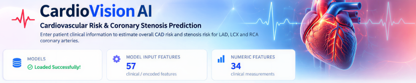
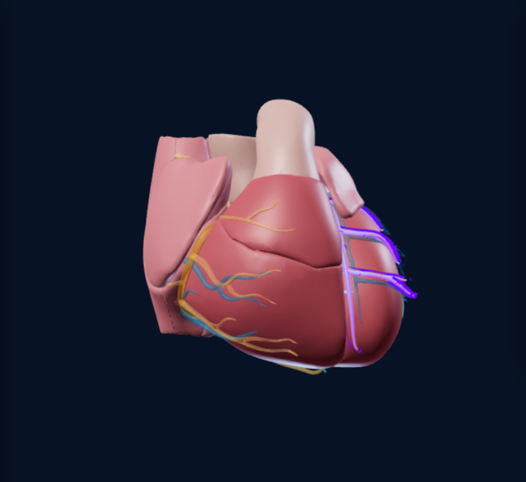
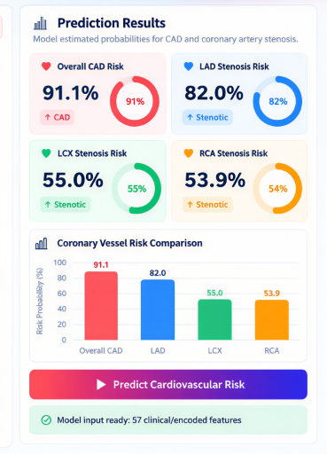
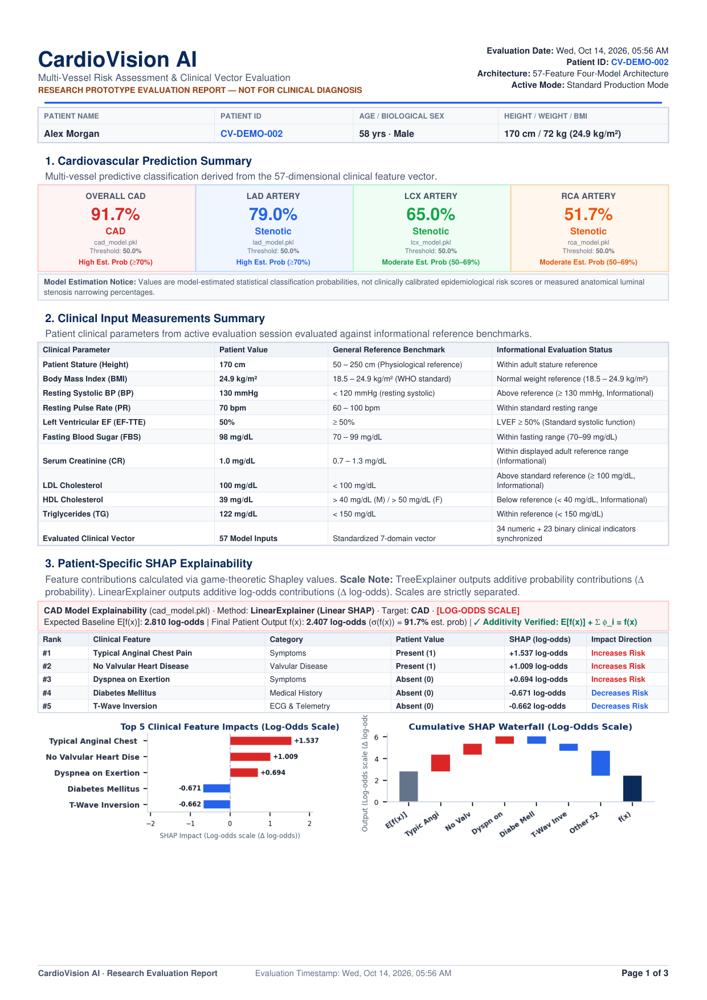

# CardioVision AI — Multi-Vessel Cardiovascular Risk Intelligence Platform

[](https://www.python.org/downloads/)
[](https://scikit-learn.org/)
[](https://threejs.org/)
[](https://www.reportlab.com/)
[]()

> **CardioVision AI** is an explainable clinical decision-support research platform for non-invasive multi-vessel coronary artery disease (CAD) risk assessment. It synthesizes a standardized 57-dimensional clinical feature vector, evaluates independent vessel-specific predictive models, delivers mathematically grounded SHAP explanations, projects spatial risk onto an interactive 106-mesh 3D heart model, and exports publication-grade medical research PDF reports.

---

## Visual Tour

| Interactive Clinical Dashboard | Three.js 106-Mesh Cardiac Spatial Overlay |
|:---:|:---:|
|  |  |

| Multi-Vessel Predictive Risk Cards | Publication-Grade 3-Page Research Report |
|:---:|:---:|
|  |  |

---

## Key Platform Features

1. **Synchronized 57-Dimensional Feature Vector**:
   - Traces 34 continuous physiological biomarkers (BP, resting pulse, EF-TTE, FBS, lipid profiles, renal panels, electrolytes, hematology) and 23 binary clinical indicators across every tier of the application.
   - Enforces an immutable `PatientFeatureSnapshot` with SHA-256 fingerprinting to eliminate data divergence between the UI, API, model vector, SHAP explanations, and exported PDF.

2. **Multi-Vessel Predictive Classification**:
   - **CAD**: Global coronary artery disease probability via regularized linear classifier.
   - **LAD**: Left Anterior Descending artery stenosis probability via gradient-boosted decision trees.
   - **LCX**: Left Circumflex artery stenosis probability via tree-based classification.
   - **RCA**: Right Coronary Artery stenosis probability via linear margin classification.

3. **Dual Operational Modes**:
   - **Standard Production Mode**: Retrospective baseline models (`cad_model.pkl`, `lad_model.pkl`, `lcx_model.pkl`, `rca_model.pkl`) using a standard 50.0% decision threshold.
   - **Experimental Candidate Mode**: Candidate models (`lcx_model_candidate.pkl`, `rca_model_candidate.pkl`) utilizing exploratory nested cross-validation decision thresholds: **LCX 0.45 (45.0%)** and **RCA 0.40 (40.0%)**.

4. **Game-Theoretic SHAP Explainability**:
   - Strictly separates additive probability scale ($\Delta\text{ probability}$) from log-odds scale ($\Delta\text{ log-odds}$) with verified additivity:
     $$E[f(x)] + \sum_{i=1}^M \phi_i = f(x)$$
   - Embeds vector-rendered horizontal feature ranking charts and step-by-step waterfall decomposition graphs.

5. **Interactive Three.js 106-Mesh 3D Cardiac Viewer**:
   - Anatomical BodyParts3D cardiac mesh assembly with dynamic vascular telemetry and real-time risk-colored arterial highlighting (LAD `#2a86ef`, LCX `#0fb77d`, RCA `#ff9900`, LM Stem `#e6d6c2`, Myocardium `#c94a53`).

6. **Publication-Grade Medical PDF Reporting**:
   - Multi-page dynamic A4 portrait report with running headers, footers (`Page X of Y`), validated physiological stature/BMI assessments, complete laboratory summaries, enlarged 3D heart snapshot, and model reliability benchmarks.
   - Strict payload verification: Mismatched predictions or stale explanations are rejected with `InconsistentPayloadError` (HTTP 400 Bad Request) rather than silently auto-substituted.

---

## System Architecture

```mermaid
flowchart TD
    subgraph UI ["User Interface Layer"]
        A[Clinical Form / Active Dashboard] --> B[Three.js 106-Mesh 3D Heart Viewer]
    end

    subgraph API ["REST API Layer (Port 8502)"]
        C[POST /api/predict]
        D[POST /api/generate-pdf]
        E[GET /api/health]
    end

    subgraph Core ["Data Integrity Core"]
        F[create_patient_feature_snapshot]
        G[Immutable PatientFeatureSnapshot<br/>• Raw Patient Data<br/>• 1x57 DataFrame X<br/>• SHA-256 Hash]
        H[verify_snapshot_consistency]
    end

    subgraph ML ["Machine Learning & Explainability Engine"]
        I[Standard Baseline Models<br/>CAD, LAD, LCX, RCA]
        J[Experimental Candidate Models<br/>LCX Thresh: 0.45 | RCA Thresh: 0.40]
        K[SHAP Service<br/>TreeExplainer & LinearExplainer]
    end

    subgraph Output ["Clinical Reporting Layer"]
        L[NumberedCanvas Multi-Page Engine]
        M[A4 3-Page Publication PDF Report]
    end

    A -->|Serialized JSON| C
    A -->|Snapshot Data URL| D
    C --> F
    D --> F
    F --> G
    G --> I
    G --> J
    I --> K
    J --> K
    G --> H
    K --> H
    H -->|Validated Payload| L
    H -.->|Inconsistent Payload| N[InconsistentPayloadError / HTTP 400]
    L --> M
```

---

## Model Performance & Reliability

### Standard Production Mode
Evaluated on retrospective held-out test cohort data:

| Target Vascular Outcome | Model File | Accuracy | F1 Score | ROC-AUC | Decision Threshold |
|---|---|:---:|:---:|:---:|:---:|
| **Overall CAD** | `cad_model.pkl` | **85.2%** | 89.7% | **0.917** | 50.0% |
| **LAD Stenosis** | `lad_model.pkl` | **65.6%** | 67.7% | **0.756** | 50.0% |
| **LCX Stenosis** | `lcx_model.pkl` | **57.4%** | 53.6% | 0.584 | 50.0% |
| **RCA Stenosis** | `rca_model.pkl` | **60.7%** | 50.0% | 0.652 | 50.0% |

> **Reliability Notice**: Standard LCX and RCA baseline models exhibit limited discriminatory power in development cohort testing (ROC-AUC 0.584 and 0.652). Probabilities must be interpreted with extreme caution and never guide clinical interventions independently.

### Experimental Candidate Mode
Evaluated via exploratory nested threshold cross-validation:

| Target Vascular Outcome | Candidate Model File | Macro F1 | Stenotic Recall | Precision | Balanced Accuracy | Tuned Decision Threshold |
|---|---|:---:|:---:|:---:|:---:|:---:|
| **LCX Candidate** | `lcx_model_candidate.pkl` | **0.689** | **0.597** | **0.634** | **0.687** | **45.0% (0.45)** |
| **RCA Candidate** | `rca_model_candidate.pkl` | **0.651** | **0.632** | **0.545** | **0.657** | **40.0% (0.40)** |

> **Candidate Cross-Validation Notice**: LCX and RCA candidate models report exploratory nested threshold cross-validation metrics. Accuracy and ROC-AUC were not evaluated for candidate models. These exploratory research metrics must not be confused with or reported as Standard mode metrics.
>
> **Methodology Verification & Saved Results**: All candidate nested-CV metrics are backed by the reproducible evaluation code in [`evaluate_nested_cv.py`](evaluate_nested_cv.py) (5-fold outer Stratified CV × 3-fold inner threshold calibration on the 57 clinical features) and saved in [`nested_cv_results.json`](nested_cv_results.json). Execute `python evaluate_nested_cv.py` to re-run the verification pipeline and inspect per-fold metrics.

---

## Installation & Setup

### Prerequisites
- Python 3.10, 3.11, or 3.12
- Modern web browser with WebGL hardware acceleration enabled

### 1. Clone Repository & Create Environment
```bash
git clone https://github.com/cardiovision/cardiovision-ai.git
cd cardiovision-ai

# Create virtual environment
python -m venv venv

# Activate virtual environment
# Windows:
venv\Scripts\activate
# Linux/macOS:
source venv/bin/activate

# Install all dependencies
pip install -r requirements.txt
```

### 2. Start the Backend API Server
```bash
python api_server.py
```
*The server initializes on `http://127.0.0.1:8502` and pre-loads all 6 machine learning models and SHAP explainers.*

### 3. Launch the Dashboard
You can access the CardioVision AI interface in two ways:
- **Interactive Streamlit Web App**:
  ```bash
  streamlit run app.py
  ```
- **Direct Standalone Dashboard**:
  Open `cardiovision_exact_dashboard.html` directly in any modern browser.

---

## Automated Verification & Test Evidence

CardioVision AI includes comprehensive test suites enforcing mathematical additivity, model separation, and zero silent data mutation:

### 1. Full 57-Feature Clinical Synchronization Suite
Traces all 57 features across Dashboard, Serialized API, Model Vector $X$, SHAP Explanations, and PDF Demographics:
```bash
python verify_57_features_sync.py
```
**Outcome: 100% PASS (57/57 features synchronized across all 5 tiers)**

### 2. Comprehensive 12/12 End-to-End Regression Suite
Verifies standard/experimental PDF generation, normal/implausible BMI math, Tree/Linear SHAP scales, 3D WebGL captures, and state isolation:
```bash
python verify_all_12_tests.py
```
**Outcome: 12/12 TESTS PASSED**

### 3. API & Rejection Verification Suite
Verifies that mismatched predictions or stale cached explanations strictly raise `InconsistentPayloadError` and return `HTTP 400 Bad Request`:
```bash
python verify_prediction_shap_synchronization.py
```
**Outcome: 5/5 TESTS PASSED**

---

## Repository Structure

```text
CardioVision-AI/
├── api_server.py                   # High-performance REST API backend (Port 8502)
├── app.py                          # Streamlit clinical dashboard application
├── candidate_thresholds.json       # Experimental decision thresholds (LCX: 0.45, RCA: 0.40)
├── cardiovision_exact_dashboard.html # Standalone Three.js 106-mesh dashboard
├── patient_feature_snapshot.py     # Immutable 57-feature snapshot & consistency validator
├── pdf_generator.py                # 3-page dynamic medical research PDF generator
├── shap_service.py                 # Tree & Linear SHAP explainability calculations
├── requirements.txt                # Complete production dependencies
├── cad_model.pkl                   # CAD predictive model (Linear/Logistic)
├── lad_model.pkl                   # LAD predictive model (Gradient Boosting)
├── lcx_model.pkl                   # Standard LCX predictive model (Random Forest)
├── lcx_model_candidate.pkl         # Experimental LCX candidate model
├── rca_model.pkl                   # Standard RCA predictive model (Ridge/Linear)
├── rca_model_candidate.pkl         # Experimental RCA candidate model
├── feature_columns.pkl             # Canonical 57-column feature order
├── numeric_defaults.pkl            # Population median fallback reference vector
├── docs/
│   └── screenshots/                # System screenshots and rendered PDF pages
├── test_output/                    # Generated test PDFs and verification artifacts
├── verify_57_features_sync.py      # 57-feature clinical synchronization test suite
├── verify_all_12_tests.py          # 12-test end-to-end regression test suite
└── verify_prediction_shap_synchronization.py # API & SHAP synchronization test suite
```

---

## Research Limitations & Regulatory Disclaimer

> ### RESEARCH PROTOTYPE — NOT A CERTIFIED MEDICAL DEVICE
> **CardioVision AI is strictly a scientific research prototype and educational demonstration.**
> - It is **NOT** approved, cleared, or certified by any regulatory agency (such as the US FDA, European CE Mark, or Japanese PMDA) for clinical diagnosis, prognosis, or medical decision-making.
> - Machine learning risk estimates represent statistical pattern matching against retrospective datasets and cannot substitute for coronary computed tomography angiography (CCTA), invasive coronary angiography (ICA), fractional flow reserve (FFR), or formal clinical examination by a board-certified cardiologist.
> - Never claim prospective clinical validation.

---

## License

This project is licensed under the Apache 2.0 License.
